<div align="center">

# SECAP Server

**Security Compliance & Audit Platform** — automated OpenSCAP/Nessus auditing and safe, guided remediation for Linux & Windows fleets.

<!-- Place a project banner / screenshot here, e.g.: -->
<!--  -->

</div>

---

## Table of Contents

- [SECAP Server](#secap-server)
  - [Table of Contents](#table-of-contents)
  - [About](#about)
  - [Key Features](#key-features)
  - [Tech Stack](#tech-stack)
  - [Project Structure](#project-structure)
  - [Architecture](#architecture)
  - [Getting Started](#getting-started)
    - [Prerequisites](#prerequisites)
    - [Local Development (Docker)](#local-development-docker)
    - [Production Deployment](#production-deployment)
    - [Running without Docker (Python only)](#running-without-docker-python-only)
  - [Configuration](#configuration)
  - [Documentation](#documentation)
  - [Screenshots](#screenshots)

## About

**SECAP Server** (Security Compliance & Audit Platform) is a Django-based platform for auditing the security compliance of Linux and Windows servers and remediating findings in a controlled, auditable way.

It orchestrates **OpenSCAP** (SCAP Security Guide) and **Nessus** scans against registered clients over SSH/WinRM, parses and stores the results (`Finding`s per `Benchmark`/`Scan`), and lets operators turn failed checks into **Remediation Plans** that are executed by Celery workers — with built-in protections (`ProtectedService` catalog) to avoid remediation actions that would break critical services like `sshd`.

The project ships with a full Docker-based stack (PostgreSQL, Redis, Celery, Flower, Nginx, HashiCorp Vault, Portainer, and a Docusaurus documentation site), plus an offline OpenSCAP content repository for air-gapped environments.

## Key Features

- **Client inventory & connectivity** — register Linux/Windows hosts, track OS family/version, and verify reachability (`RemoteConnectivityLog`) before scanning.
- **Automated compliance scanning** — run OpenSCAP (SCAP Security Guide datastreams) and Nessus scans against clients over SSH (Linux) or WinRM/PsExec (Windows).
- **Benchmark & profile management** — import/build SCAP benchmarks and bundles, select profiles per scan.
- **Findings & compliance status** — parse scan results into structured `Finding` records with severity, pass/fail/N-A status.
- **Guided remediation** — generate a `RemediationPlan` from failed findings, execute `RemediationJob`s via Celery, and snapshot system state before/after changes (`RemediationSnapshot`).
- **Protected service catalog** — a curated, documented list of SSG rule-id patterns (SSH, networking, etc.) that are excluded from automated remediation to prevent lockouts.
- **Audit trail** — `RemediationAuditLog` and `django-simple-history` track who changed what and when.
- **Secrets management** — credentials for client access are encrypted (Fernet) and can be backed by HashiCorp Vault in production.
- **LDAP integration** — sync clients/users from an LDAP directory (`LDAPConfiguration`).
- **Modern admin UI** — built on `django-unfold` with import/export, filters, DjangoQL search, and object-level permissions (`django-guardian`).
- **Scheduled scans** — periodic tasks via `django-celery-beat`, monitored through Flower.
- **Offline OpenSCAP repository** — a self-hosted APT/YUM-style repo (`repo/` service) so target hosts without internet access can still install `oscap` tooling.
- **i18n** — English and Farsi (فارسی) UI support.

## Tech Stack

| Layer                | Technology |
|-----------------------|------------|
| Language / Runtime    | Python 3.13, [uv](https://github.com/astral-sh/uv) for dependency management |
| Web framework         | [Django 5.2](https://www.djangoproject.com/) |
| Admin UI              | [django-unfold](https://github.com/unfoldadmin/django-unfold), `django-modeltranslation`, `djangoql`, `django-import-export` |
| Database              | PostgreSQL 16 (via `dj-database-url` / `psycopg`) |
| Task queue            | [Celery](https://docs.celeryq.dev/) + Redis (broker & result backend), `django-celery-beat` for schedules, [Flower](https://flower.readthedocs.io/) for monitoring |
| Compliance scanning   | [OpenSCAP](https://www.open-scap.org/) / SCAP Security Guide, Nessus (`.nessus` result parsing) |
| Remote execution      | SSH (`asyncssh`, `sshpass`) for Linux, WinRM/PsExec (`pypsexec`) for Windows |
| Secrets               | Fernet field encryption, [HashiCorp Vault](https://www.vaultproject.io/) (production) |
| Static/media files    | WhiteNoise, Pillow |
| Auth & permissions    | `django-guardian` (object-level permissions), LDAP sync (`ldap3`) |
| Data parsing           | `lxml`, `pandas`, `beautifulsoup4`, `openpyxl` |
| Observability         | Sentry SDK, Loguru |
| Docs site             | [Docusaurus](https://docusaurus.io/) (TypeScript/React, Node.js) — `docs/` |
| Reverse proxy (prod)  | Nginx with TLS termination |
| Containers            | Docker & Docker Compose (multi-stage `Dockerfile`, separate `dev`/`prod` compose files) |
| Container management  | Portainer |

## Project Structure

```text
secapserver/
├── src/                          # Django project root (PYTHONPATH)
│   ├── manage.py
│   ├── secapserver/              # Project config: settings, celery app, wsgi/asgi
│   │   ├── settings/
│   │   │   ├── base.py           # Shared settings
│   │   │   ├── dev.py            # Development overrides
│   │   │   └── prod.py           # Production overrides
│   │   ├── celery.py
│   │   ├── middleware.py
│   │   ├── wsgi.py / asgi.py
│   ├── core/                     # Cross-cutting app: users, auth, base models, admin theme
│   │   ├── models.py             # User, Profile, Tag, sample racing-data models
│   │   ├── admin.py              # Unfold admin site config
│   │   ├── urls.py               # Root URL conf
│   │   └── views.py
│   ├── audit/                    # Scanning & compliance domain
│   │   ├── models.py             # Client, Scan, Finding, Benchmark(Bundle/Profile), LDAPConfiguration
│   │   ├── services/             # OpenSCAP/Nessus scanners, SCAP parsing, LDAP sync, SSH helpers
│   │   ├── tasks/                # Celery tasks: scanning, discovery, health checks, bundle builds
│   │   ├── utils/                # oscap/nessus result parsers, Windows audit executor, ping/SSH utils
│   │   ├── constants.py          # Shared lookup tables & config (no side effects)
│   │   └── admin.py
│   ├── remediation/               # Remediation domain
│   │   ├── models.py              # RemediationPlan, RemediationJob, RemediationSnapshot, ProtectedService, RemediationAuditLog
│   │   ├── services.py            # Plan creation from scans, business logic
│   │   ├── tasks.py               # Celery remediation execution tasks
│   │   ├── constants.py           # PROTECTED_SERVICE_CATALOG (safety rules)
│   │   └── admin.py
│   ├── templates/                 # Django templates
│   ├── static/                    # App static assets (per-app + admin theme)
│   └── media/                     # User-uploaded files (runtime)
├── docs/                          # Docusaurus documentation site (Node.js/React)
├── nginx/                         # Reverse proxy config + TLS certs (production)
├── repo/                          # Offline OpenSCAP package repository (linux/, windows/)
├── docker-compose/                # Extra compose fragments/helpers
├── Dockerfile                     # Multi-stage build: builder / development / production
├── docker-compose.dev.yml         # Local development stack
├── docker-compose.prod.yml        # Production stack (adds Nginx, Vault)
├── download-openscap-repos.sh     # Builds the offline OpenSCAP repo for supported distros
├── setup.sh                       # Interactive setup wizard (dev/prod bootstrap)
├── pyproject.toml / uv.lock       # Python dependencies (uv)
├── .env.dev / .env.prod           # Environment variables per stage
└── .python-version
```

## Architecture

```text
                         ┌──────────────┐
                         │    Nginx     │  (production only, TLS termination)
                         └──────┬───────┘
                                │
        ┌────────────┬─────────┼─────────┬─────────────┬──────────────┐
        ▼            ▼         ▼         ▼             ▼              ▼
   ┌────────┐   ┌─────────┐┌────────┐┌──────────┐ ┌───────────┐ ┌───────────┐
   │  web   │   │ flower  ││ docs   ││ portainer│ │   repo    │ │   vault   │
   │(Django)│   │(Celery  ││(Docusau││ (Docker  │ │ (OpenSCAP │ │ (secrets, │
   │        │   │ monitor)││rus)    ││  admin)  │ │  offline) │ │  prod)    │
   └───┬────┘   └────┬────┘└────────┘└──────────┘ └───────────┘ └───────────┘
       │             │
       ▼             ▼
  ┌──────────┐   ┌───────────────┐        ┌────────────────┐
  │PostgreSQL│   │ Redis (broker)│◀──────▶│ celery_worker /│
  │  (db)    │   │               │        │ celery_beat    │
  └──────────┘   └───────────────┘        └────────┬───────┘
                                                   │ SSH / WinRM
                                                   ▼
                                     ┌───────────────────────────┐
                                     │ Target Clients (Linux/Win)│
                                     │  oscap / Nessus scans,    │
                                     │  remediation execution    │
                                     └───────────────────────────┘
```

The Django app (`web`) handles the admin UI and API surface. Long-running work — scans, remediation jobs, LDAP sync, health checks — is dispatched to **Celery workers**, scheduled by **Celery Beat**, and monitored via **Flower**. Results and audit data live in **PostgreSQL**; **Redis** is the Celery broker/result backend. Target hosts are reached over **SSH** (Linux) or **WinRM/PsExec** (Windows) to run `oscap`/Nessus scans and, where safe, apply remediations.

## Getting Started

### Prerequisites

- [Docker](https://docs.docker.com/get-docker/) and [Docker Compose](https://docs.docker.com/compose/)
- (Optional, for running outside Docker) Python 3.13+ and [uv](https://github.com/astral-sh/uv)

### Local Development (Docker)

```bash
# 1. Adjust environment variables for the dev stage
edit .env.dev   # SECRET_KEY, POSTGRES_*, REDIS_PASSWORD, FLOWER_*, ports, etc.

# 2. Run the guided setup wizard (choose "dev")
./setup.sh

# — or start the stack manually —
docker compose -f docker-compose.dev.yml up --build
```

Once running:

| Service            | URL                              |
|---------------------|-----------------------------------|
| Django app          | http://localhost:8000            |
| Django admin        | http://localhost:8000/admin/     |
| Flower (Celery UI)  | http://localhost:5555            |
| Docs site           | http://localhost:8888            |
| Portainer           | http://localhost:9000            |
| OpenSCAP repo       | http://localhost:8080            |

### Production Deployment

```bash
./setup.sh              # choose "prod"
# — or —
docker compose -f docker-compose.prod.yml up --build -d
```

The production stack adds **Nginx** (TLS termination, reverse proxy for all services) and **HashiCorp Vault** (secrets storage) in front of the same core services.

### Running without Docker (Python only)

```bash
uv sync
source .venv/bin/activate
export DJANGO_SETTINGS_MODULE=secapserver.settings.dev
cd src
python manage.py migrate
python manage.py runserver
```

## Configuration

Environment variables are defined per stage in `.env.dev` / `.env.prod` and consumed by `src/secapserver/settings/base.py`, `dev.py`, and `prod.py`. Key variables include:

- `SECRET_KEY` — Django secret key (also used as the field-encryption key)
- `DATABASE_URL` — PostgreSQL connection string
- `CELERY_BROKER_URL` / `CELERY_RESULT_BACKEND` — Redis connection
- `ALLOWED_HOSTS`, `CSRF_TRUSTED_ORIGINS` — domain configuration
- `POSTGRES_*`, `REDIS_PASSWORD`, `FLOWER_USER` / `FLOWER_PASSWORD` — service credentials
- `VAULT_TOKEN` — HashiCorp Vault root token (production)
- `OPENSCAP_REPO_URL` — base URL of the offline OpenSCAP repo used to auto-provision `oscap` on targets

See `.env.dev` / `.env.prod` for the full list of expected variables (not committed with real secrets — treat as templates).

## Documentation

Full docs (setup guides, architecture notes) live in the `docs/` [Docusaurus](https://docusaurus.io/) site:

```bash
cd docs
npm install
npm run start
```

Or via Docker: it's already wired up as the `docs` service in both compose files (see [Local Development](#local-development-docker)).

## Screenshots

**Run the project look like**
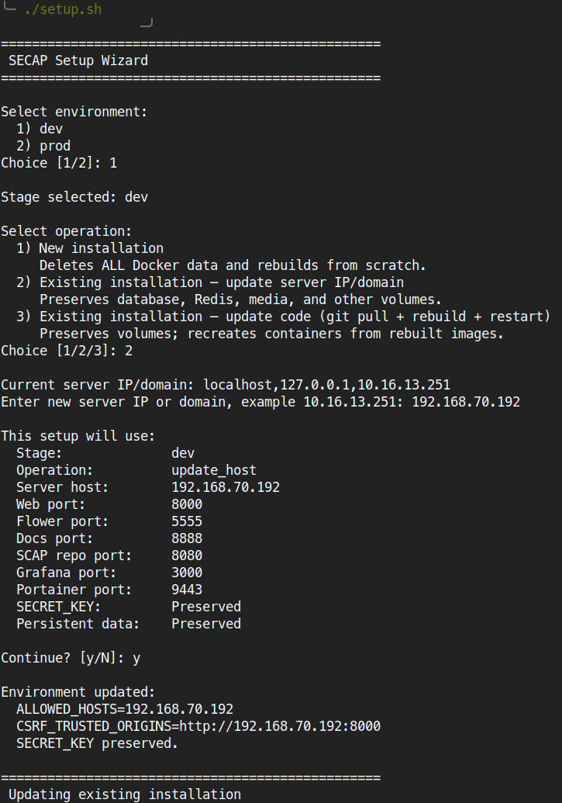
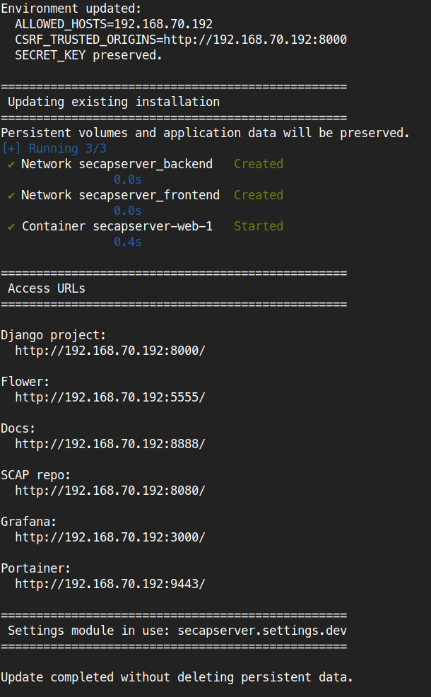

**LoginPage**
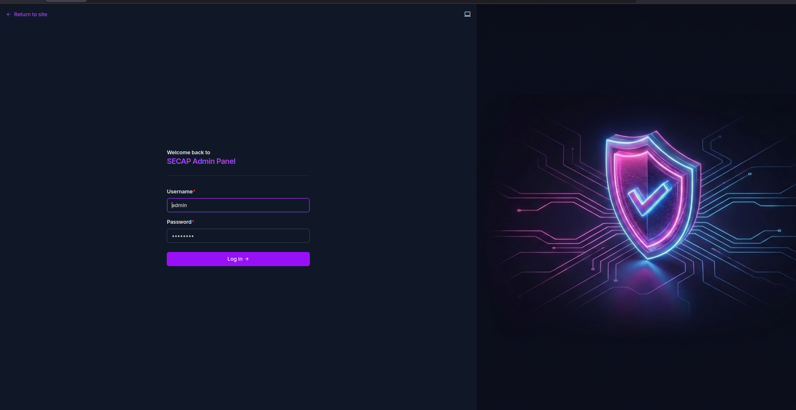

**SECAP Dashboards**
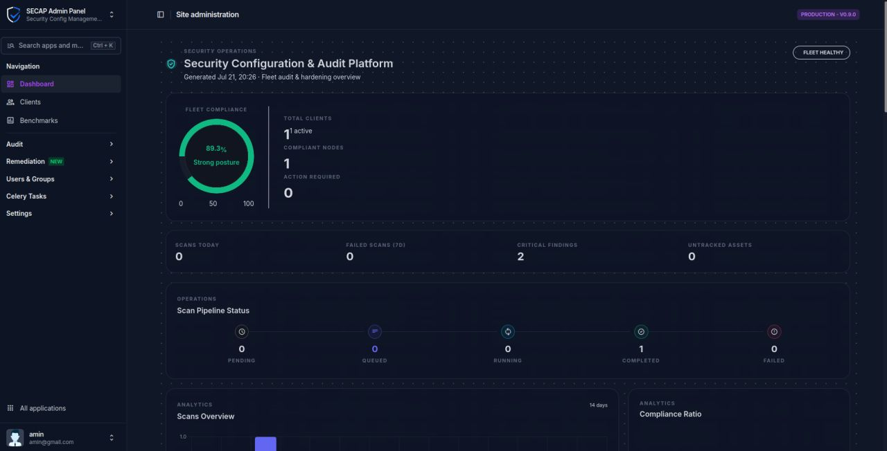

**SECAP Clients**
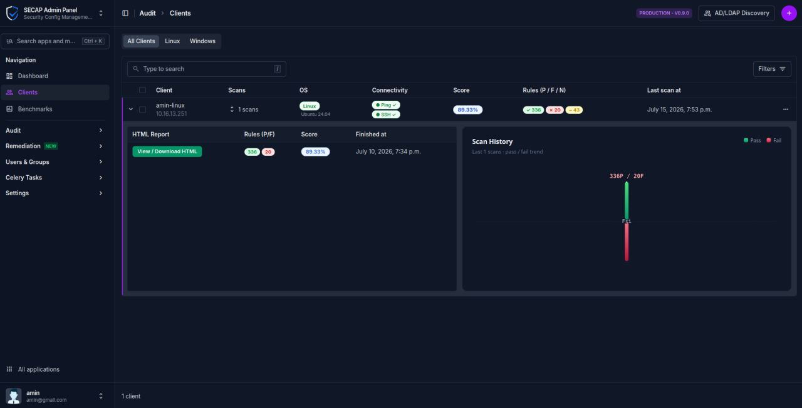

**SECAP Benchmarks**
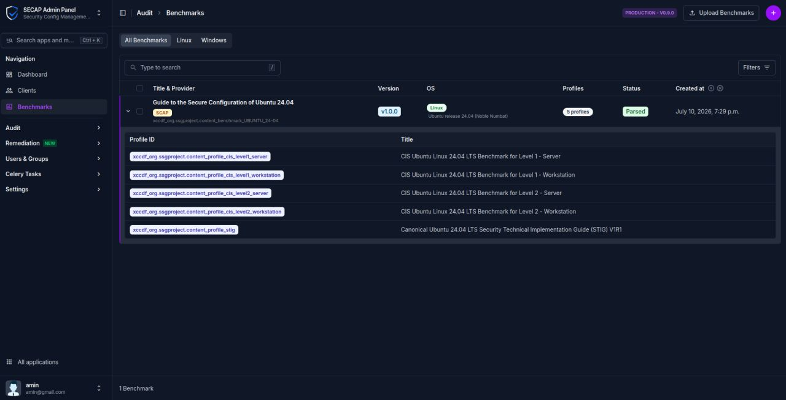

**SECAP Scans**
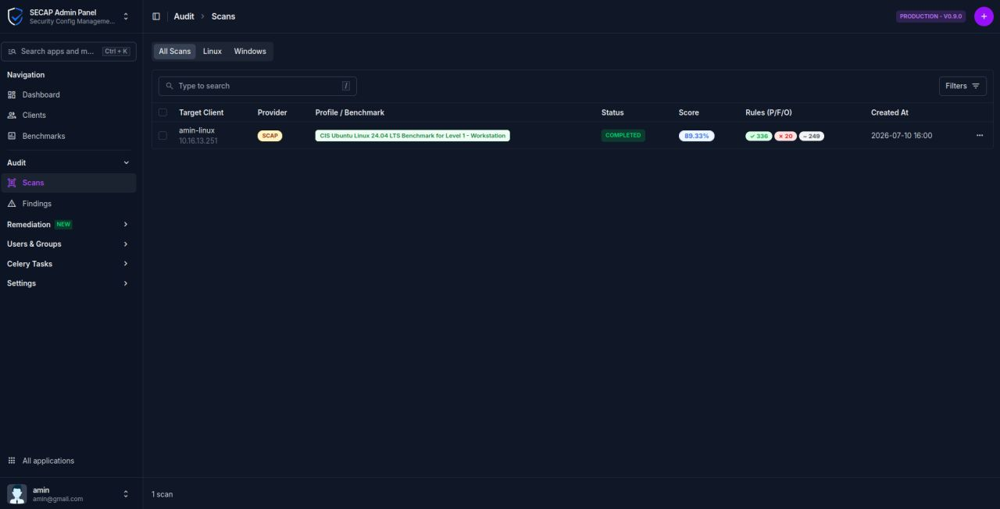

**SECAP Findings**
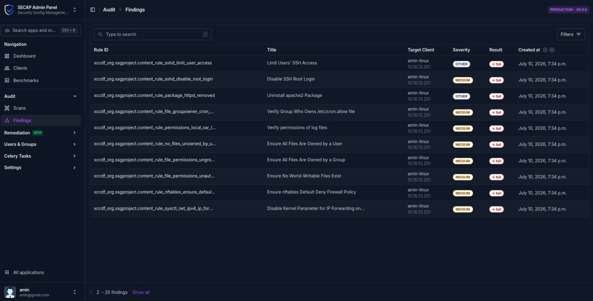

**SECAP Documentation**
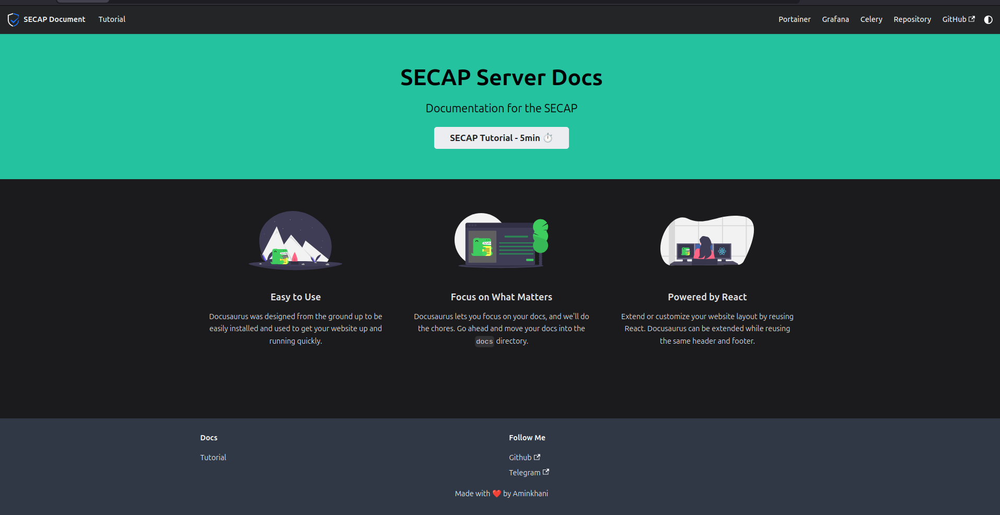

**Portainer Dashboard**
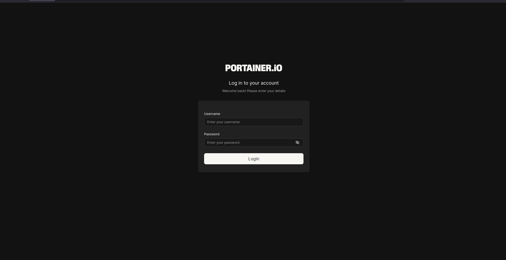

**Flower Dashboard**
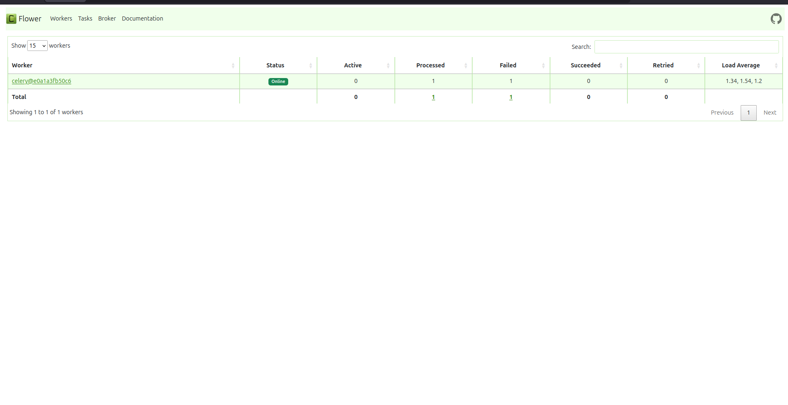